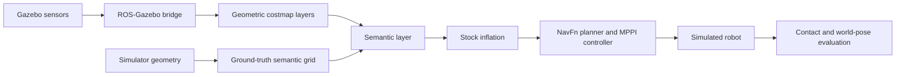

# semantic-nav-ros

**Graduated semantic costs for ROS 2 Nav2, with a reproducible Gazebo navigation benchmark.**

This project adds a reusable Nav2 costmap layer that represents traversable
terrain with intermediate costs and obstacles with lethal costs. In the
benchmark, grass receives cost **40** and glass receives **254**, allowing the
planner to weigh a clean detour against crossing grass.

The glass wall physically blocks the robot and remains visible to the camera,
but produces no LiDAR returns from the panel itself. This tests the value of
semantic obstacle insertion when geometric sensing misses an obstacle.

**Current scope:** simulation research. The implemented semantic inputs come
from simulator ground truth. Camera projection and latency utilities exist;
the Pi-hosted cloud-VLM pipeline is not yet deployed. This repository does
not currently demonstrate end-to-end camera-based navigation or physical
robot safety.

## Start here

- [Detailed code and syntax guide](docs/code_and_syntax_guide.md) — architecture,
  file walkthroughs, C++/Python/ROS syntax, mathematics, and examples.
- [Semantic layer interface](ros2_ws/src/semantic_nav_costmap_layer/README.md) —
  message contract, parameters, merge behavior, and integration.
- [Experiment preregistration](docs/experiments/oct13_preregistration.md) —
  fixed conditions, seeds, metrics, and exclusions.
- [Pilot results and limitations](docs/experiments/oct13_status.md).
- [Campaign execution runbook](docs/experiments/oct18_execution.md).
- [Project working rules](AGENTS.md).

## Architecture



The baseline omits the semantic producer and layer. Evaluation-only simulator
poses are never supplied to localization or navigation TF.

| Component | Purpose |
|---|---|
| `ros2_ws/src/semantic_nav_costmap_layer` | Independent C++ Nav2 plugin |
| `ros2_ws/src/semantic_nav_sim` | Arena, robot, launch files, oracle, trial runner, and metrics |
| `ros2_ws/src/semantic_nav_perception` | Pure Python projection/latency utilities; not a deployed ROS node |
| `scripts` | Campaign orchestration, analysis, audits, and diagnostics |
| `docs` | Code guide, protocols, evidence, and manuscript drafts |
| `results` | Generated trial data, manifests, logs, and runtime files |

The reusable plugin has no dependency on the simulation package.

## Environment and build

The development environment is **Ubuntu 24.04 / WSL2, ROS 2 Jazzy, and Gazebo
Harmonic**. Headless simulation is the primary target. The robot uses Gazebo's
native differential-drive and joint-state systems through `ros_gz_bridge`.

These instructions assume the required system dependencies are already
installed: ROS 2 Jazzy, Nav2, Gazebo Harmonic, ROS-Gazebo integration, Xacro,
robot state publisher, colcon/ament, and the Python dependencies declared in
[the simulation package manifest](ros2_ws/src/semantic_nav_sim/package.xml).
The plugin's dependencies are declared in
[its manifest](ros2_ws/src/semantic_nav_costmap_layer/package.xml).

From the repository root, in a terminal where no experiment is running:

```bash
source env.sh
colcon --log-base ros2_ws/log build \
  --base-paths ros2_ws/src \
  --build-base ros2_ws/build \
  --install-base ros2_ws/install \
  --packages-up-to semantic_nav_sim
source env.sh
```

`env.sh` sets `ROS_DOMAIN_ID=47` and sources this workspace. Source it manually
per terminal; do not add it to global shell configuration or combine this
workspace with an unrelated ROS workspace. Keep project artifacts inside this
repository. Do not rebuild or modify experimental code during a frozen batch.

## Run a development trial

Use the wrapper from the repository root in a normal host terminal. It sets
project-local ROS/Gazebo logs, caches, and temporary directories. Run only one
simulation or camera diagnostic at a time.

```bash
bash scripts/phase0.sh \
  --scenario glass_wall \
  --condition ground_truth \
  --trials 1 \
  --seed 20261012 \
  --rtf 0.5 \
  --cooldown-sec 0 \
  --max-linear-speed 0.25 \
  --timeout 90 \
  --out results/development/glass_ground_truth.csv
```

Choose a **new output filename for every development run**; the runner refuses
to overwrite an existing CSV. Development runs are separate from fixed pilot
and campaign samples.

| Condition | Input | Glass | Grass |
|---|---|---:|---:|
| `baseline` | Stock geometric navigation; no semantic input | — | — |
| `ground_truth` | Simulator-derived semantic geometry | 254 | 40 |
| `binary` | Identical simulator-derived geometry | 254 | 254 |
| `cloud_vlm` | Planned image/cloud pipeline | Pending | Pending |

The trial runner supports the first three conditions. The campaign declares
`cloud_vlm` but refuses to execute it until implemented.

The principal scenarios are `glass_wall`, `route_choice` (short clean detour),
and `forced_crossing` (long clean detour). The older `grass_patch` scenario
is retained for historical harness evidence.

All experimental arms use the same protocol: **RTF 0.5, 1 ms physics step,
zero cooldown, a fresh worker process per trial, maximum linear speed
±0.25 m/s, and a 90 simulated-second navigation timeout**. The speed cap is
the authorized common change to otherwise stock planner/controller settings.
Use the harness rather than direct launch commands to generate the correct
per-condition parameters.

## Fixed campaign

The declared campaign contains 30 matched start-jitter seeds across three
scenarios and four conditions: **360 planned attempts**, including 90 cloud
attempts that remain pending while that condition is unavailable.

Planning writes the schedule and derived availability file without starting
ROS or consuming a trial:

```bash
bash scripts/phase0.sh campaign plan
```

When no other batch is active, the documented command to start or resume the
ready arms is:

```bash
bash scripts/phase0.sh campaign run --available baseline binary ground_truth
```

Read the [execution runbook](docs/experiments/oct18_execution.md) first. Resume
skips consistent completed evidence and refuses incomplete attempts. Do not
delete partial artifacts or replace failed/excluded attempts to force resume.
A completed attempt is not necessarily successful. The
[campaign launch record](docs/experiments/oct18_status.md) is a historical
handoff, not a live progress dashboard or a claim of campaign completion.

## Results and interpretation

Each run retains CSV outcomes, generated worlds/configuration, source hashes,
contact events, estimated and actual trajectories, command intervals,
resource snapshots, and launch logs.

- `nav2_result` records the action result. It does not establish physical arrival.
- `success` requires Nav2 goal success **without obstacle contact**.
- `physical_goal_reached` separately checks actual final distance ≤0.25 m.
- `usable` applies infrastructure and command-gap criteria; it is independent
  of navigation success. The original all-command-gap cutoff is 18 Hz.
- Infrastructure failures have empty navigation-result/success fields and
  remain distinct from navigation failures.
- Navigation duration is reported in simulated seconds. A bounded wall
  watchdog handles stalls; host timing is not a validated scientific clock.

The completed October 13 pilot retained **90 attempts with 90 clean teardowns**;
**69/90 were usable**. Its aggregate usability was below 90%, and command-gap
exclusions overlapped navigation failures. Read the
[full pilot tables and evidence](docs/experiments/oct13_status.md) before
interpreting usable-only results. Pilot observations are not campaign results.

## Tests

Existing Python checks can be run from the repository root:

```bash
python3 scripts/test_campaign_plan.py
bash scripts/phase0.sh test
PYTHONPATH="$PWD/ros2_ws/src/semantic_nav_perception" \
  python3 -m unittest discover \
  -s ros2_ws/src/semantic_nav_perception/tests -v
```

The C++ layer tests are integrated with ament/GoogleTest. After building, run
them in an idle host terminal with project-local ROS and temporary directories:

```bash
source env.sh
mkdir -p results/phase0/runtime/ros/log results/phase0/runtime/tmp
export ROS_HOME="$PWD/results/phase0/runtime/ros"
export ROS_LOG_DIR="$ROS_HOME/log"
export TMPDIR="$PWD/results/phase0/runtime/tmp"
colcon --log-base ros2_ws/log test \
  --build-base ros2_ws/build \
  --install-base ros2_ws/install \
  --packages-select semantic_nav_costmap_layer \
  --event-handlers console_direct+
colcon test-result --test-result-base ros2_ws/build --verbose
```

Tests cover implementation behavior; benchmark efficacy requires retained
experimental evidence. These commands are documentation, not a statement
that a fresh build or full test suite was run for this README change.

## Current limitations

The ground-truth producer is omniscient; it does not validate perception.
Grass exposure measures the robot centerline, not the whole swept footprint.
Some planned detours fail during execution. Reduced RTF changes controller
timing relative to physics, and host-clock uncertainty remains accepted.

The proposed cloud localization method assumes a calibrated camera, known
planar floor, and visible glass base. Stationary manual projection evidence
does not establish VLM accuracy or moving-camera performance. Pi deployment,
provider configuration, application acknowledgements, and live end-to-end
latency measurements remain unfinished. See the
[cloud design and validation limits](docs/experiments/cloud_localization_design.md).
Local Pi model comparisons and physical robot validation are future work.

## License

Both ROS package manifests declare **Apache-2.0**. The existing license text
is in [semantic_nav_sim/LICENSE](ros2_ws/src/semantic_nav_sim/LICENSE).
