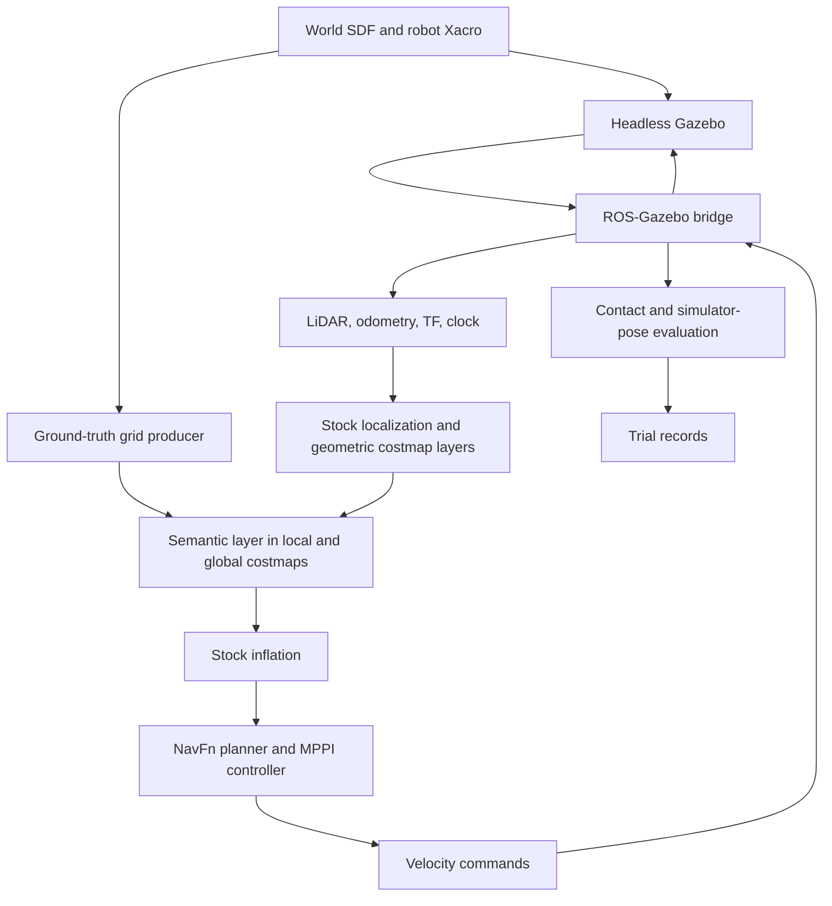

# semantic-nav-ros: code and syntax guide

This guide explains the implementation inspected at commit `e8cb8a3`, before
this documentation addition. It is intended for someone learning how the
Python, C++, ROS 2, Gazebo, configuration, and experiment code fit together.
The proposed repository names `semantic-nav2` and `nav2-semantic-costmap` have
not renamed any package: the current project remains `semantic-nav-ros`.

This is a source-code guide, not a new experimental protocol. The binding
project rules remain in [AGENTS.md](../AGENTS.md), and trial methodology is in
[the preregistration](experiments/oct13_preregistration.md). Existing component
READMEs explain interfaces; this guide adds execution flow, syntax, mathematics,
and examples. Examples marked “illustrative” explain behavior rather than
provide complete standalone programs.

## Contents

1. [What the system does](#1-what-the-system-does)
2. [Repository map and reading order](#2-repository-map-and-reading-order)
3. [ROS concepts and data flow](#3-ros-concepts-and-data-flow)
4. [Shell entry points](#4-shell-entry-points)
5. [Launch files and Python launch syntax](#5-launch-files-and-python-launch-syntax)
6. [World, robot, XML, Xacro, and YAML](#6-world-robot-xml-xacro-and-yaml)
7. [C++ semantic layer, step by step](#7-c-semantic-layer-step-by-step)
8. [Python ground-truth producer](#8-python-ground-truth-producer)
9. [Trial lifecycle and result semantics](#9-trial-lifecycle-and-result-semantics)
10. [Campaign scheduling and evidence](#10-campaign-scheduling-and-evidence)
11. [Contact and trajectory mathematics](#11-contact-and-trajectory-mathematics)
12. [Projection and latency utilities](#12-projection-and-latency-utilities)
13. [Build system and tests](#13-build-system-and-tests)
14. [Python syntax reference](#14-python-syntax-reference)
15. [Common misunderstandings and debugging](#15-common-misunderstandings-and-debugging)
16. [Supporting scripts and glossary](#16-supporting-scripts-and-glossary)

## 1. What the system does

A conventional obstacle map primarily answers whether a location is blocked.
This project adds semantic planning penalties: a traversable grass region can
have cost 40, while a glass wall has lethal cost 254. A planner can consequently
trade a longer clean route against a shorter route through grass.

The glass benchmark separates three properties that are often conflated:

- Physical collision geometry stops the robot.
- Camera rendering makes the panel visible.
- LiDAR visibility masks suppress returns from the panel itself.

The current semantic producer reads known simulator geometry. It is an oracle,
not a camera detector. A planned cloud VLM producer will obtain image-space
labels and project them onto the floor, but its ROS/network integration is
not yet implemented at the inspected revision.

| Condition | Semantic geometry source | Glass cost | Grass cost |
|---|---|---:|---:|
| `baseline` | No semantic producer/layer | No inserted cost | No inserted cost |
| `ground_truth` | Simulator SDF | 254 | 40 |
| `binary` | Same simulator SDF | 254 | 254 |
| `cloud_vlm` | Planned camera/cloud pipeline | Planned 254 | Planned 40 |

The baseline still has geometric obstacle and inflation layers. “No inserted
cost” does not mean its costmap is entirely empty.

## 2. Repository map and reading order

All paths in this guide are relative to the repository root unless linked.

| Path | Responsibility |
|---|---|
| [env.sh](../env.sh) | Establish this project's ROS environment in the current shell |
| [scripts/phase0.sh](../scripts/phase0.sh) | Common wrapper; confines runtime files and dispatches commands |
| [semantic_nav_costmap_layer](../ros2_ws/src/semantic_nav_costmap_layer/README.md) | Reusable C++ Nav2 layer |
| `ros2_ws/src/semantic_nav_sim/` | Simulation, launch, oracle, trial runner, evaluation |
| [semantic_nav_perception](../ros2_ws/src/semantic_nav_perception/README.md) | Pure Python projection and latency utilities; not a deployed ROS package |
| `scripts/run_campaign.py` | Fixed campaign schedule and resume guard |
| `scripts/run_matched_pilot.py` | Development smoke and fixed pilot orchestration |
| `results/` | Generated run data, logs, manifests, scratch files |
| `docs/experiments/` | Protocols, design decisions, evidence, status |
| `docs/paper/` | Manuscript working material |
| `ros2_ws/build`, `install`, `log` | Generated build products, installed packages, build logs |

The plugin must not depend on the simulation package. The simulation package
can depend on the plugin. This lets another robot supply semantic grids
without importing this arena or its experimental settings.

Suggested reading order: this overview → shell wrapper → launch files →
oracle → C++ layer → trial runner → campaign runner → metrics → perception.
Do not start by reading the long trial runner linearly without its lifecycle.

## 3. ROS concepts and data flow

A **node** is a ROS participant that can publish, subscribe, provide services,
or use actions. A node is not necessarily a separate operating-system process.
A **topic** carries typed streams; a **service** is a request/reply operation;
an **action** supports a longer operation with feedback and a final result.
Navigation uses an action because reaching a goal takes time and may be
cancelled. **Lifecycle** state matters: a process existing is insufficient
if its Nav2 node has not reached its active state.

**TF** stores coordinate-frame relationships. `map` is the global localization
frame, `odom` is the odometry frame, and robot/sensor frames describe mounting
geometry. The camera optical frame uses z forward, x right, and y down.
Coordinates without their frame and timestamp are incomplete information.



This diagram describes the semantic arms. Baseline omits the producer and
semantic layer. Evaluation truth is not fed back into localization or TF.

| Interface | Type/purpose |
|---|---|
| `/semantic_costmap` | `nav2_msgs/msg/Costmap`: complete semantic snapshots |
| `/scan` | `sensor_msgs/msg/LaserScan`: simulated LiDAR |
| `/camera`, `/camera_info` | RGB image and camera calibration |
| `/cmd_vel` | `geometry_msgs/msg/Twist`: commanded linear/angular velocity |
| `/odom`, `/tf`, `/joint_states` | Motion and frame relationships |
| `/clock` | Simulated time supplied by Gazebo through the bridge |
| `/benchmark/contacts` | Obstacle contact measurements |
| `/benchmark/ground_contacts` | Ground-contact stream used in instrumentation |
| `/benchmark/robot_pose` | Evaluation-only world pose |

A costmap is a 2D array, not a probability image. The input message includes
resolution, dimensions, origin pose, frame, timestamp, and a flat byte array.
The array's row-major index is `row * width + column`.

## 4. Shell entry points

### `env.sh`

`source env.sh` executes the file in the current shell. Running `bash env.sh`
would change only a child shell's environment, which disappears when it exits.
The script clears selected ROS/colcon prefix variables and `CYCLONEDDS_URI`,
sets `ROS_DOMAIN_ID=47`, sources the system ROS installation, then sources
this workspace's installed setup if present. It does not edit global shell
configuration. Clearing these selected variables is not a general-purpose
reset of every environment variable inherited from the parent shell.

Key Bash syntax:

```bash
export ROS_DOMAIN_ID=47
if [ -f "$SEMANTIC_NAV_WS_SETUP" ]; then
    source "$SEMANTIC_NAV_WS_SETUP"
fi
```

`export` makes a variable available to child processes. `[ -f ... ]` tests
whether a regular file exists. `$VARIABLE` expands a variable. Double quotes
preserve a path as one argument even if it contains spaces. `$(command)`
substitutes command output. `${BASH_SOURCE[0]}` identifies this Bash source
file, allowing its directory to be used to locate the workspace.

### `scripts/phase0.sh`

The wrapper changes to the repository root, sources `env.sh`, creates runtime
subdirectories, and sets ROS, Gazebo, cache, configuration, temporary-file,
and Matplotlib directories under `results/phase0/runtime`.

Its first argument selects a tool. `campaign` dispatches to
`run_campaign.py`; `pilot` dispatches to the pilot runner; `test` dispatches
to simulation unit tests. Otherwise it runs the ordinary trial runner.

```bash
if [[ "${1:-}" == campaign ]]; then
    shift
    exec python3 scripts/run_campaign.py "$@"
fi
```

- `${1:-}` means the first argument, or an empty string if absent.
- `[[ ... ]]` is Bash's conditional expression syntax.
- `shift` removes that dispatch word from the positional arguments.
- `"$@"` forwards each remaining argument separately.
- `exec` replaces the shell process with the program, rather than leaving
  another wrapper process waiting for it.
- `set -e` requests exit on unhandled command failures, subject to Bash's
  conditional/pipeline rules; it is not a universal exception mechanism.

Run simulations only through the documented host workflow, with no concurrent
simulation/camera batch. This guide does not launch any experiment.

## 5. Launch files and Python launch syntax

The three launch files are in
[`semantic_nav_sim/launch`](../ros2_ws/src/semantic_nav_sim/launch).

### Robot bringup

`robot_bringup.launch.py` constructs a launch description containing:

1. `gz sim -s -r --headless-rendering` for server-only simulation and sensors.
2. `robot_state_publisher` with the expanded robot description and simulated time.
3. `ros_gz_sim create` to spawn the robot at the requested pose.
4. `ros_gz_bridge parameter_bridge` with the topic mapping YAML.

A launch description is a collection of actions interpreted by ROS launch.
It is not a synchronous Python sequence where each node finishes before the
next begins. The trial runner therefore performs explicit readiness checks.

```python
x = LaunchConfiguration('x')
DeclareLaunchArgument('x', default_value='-4.0')
```

`LaunchConfiguration` is a deferred substitution, not immediately the float
`-4.0`. The launch system resolves it when running. `DeclareLaunchArgument`
defines an exposed setting and its default. A command-line ROS launch override
uses `x:=-3.9`; the `:=` syntax belongs to ROS launch's command-line parser,
not Python assignment.

```python
ParameterValue(Command(['xacro ', xacro_path]), value_type=str)
```

`Command` expands Xacro at launch time; `ParameterValue(..., value_type=str)`
ensures the resulting XML is treated as a string parameter.

### Nav2 bringup

`nav2_bringup.launch.py` includes stock localization and navigation launch
files. It provides the static map, generated parameter file, simulated-time
setting, and autostart. It also launches `seed_initial_pose.py` to provide
an AMCL initial guess. The static LiDAR-view map intentionally omits glass
and grass: otherwise the baseline could know the glass from the static map.

`IncludeLaunchDescription` composes another launch description.
`PythonLaunchDescriptionSource` identifies a Python launch file.
`launch_arguments={...}.items()` supplies name/value pairs to the included file.
`get_package_share_directory(...)` resolves the installed package's resources,
which may differ from an edited source file if the installation is stale.

### Combined bringup

`bringup_all.launch.py` includes both bringup files and conditionally starts
the oracle for non-baseline conditions. It forwards world, pose, and parameter
arguments. `LaunchConfigurationNotEquals('condition', 'baseline')` is evaluated
by launch, rather than by an ordinary Python `if` at import time.

Crucial distinction: the trial runner generates the semantic-layer configuration
and binary grass cost. Selecting a launch condition alone is not a substitute
for the full harness: the launch file's default parameter file is baseline,
and its default `grass_cost` is 40. Use the harness for comparable arms.

## 6. World, robot, XML, Xacro, and YAML

### XML and SDF

[`arena.sdf`](../ros2_ws/src/semantic_nav_sim/worlds/arena.sdf) describes the
world, physics, models, lights, visuals, collisions, and contact sensors.

```xml
<physics name="1ms" type="ignored">
  <max_step_size>0.001</max_step_size>
  <real_time_factor>1.0</real_time_factor>
</physics>
```

`<physics>` is an element; `name` and `type` are attributes. The closing
`</physics>` terminates it. A tag such as `<static>true</static>` contains a
text value interpreted by the SDF loader. A self-closing `<plugin .../>` has
attributes but no child content. `<!-- ... -->` is a comment.

The source world has RTF 1.0. For trials, `run_trials.py` writes a generated
world with RTF 0.5. The physics step stays 0.001 seconds. Always inspect the
saved generated SDF to determine a trial's actual input.

A model pose contains `x y z roll pitch yaw`. A `<visual>` controls rendering;
a `<collision>` controls physical interaction. A visually transparent object
is not automatically LiDAR-transparent. This benchmark deliberately uses
sensor visibility masks and visual visibility flags while retaining collision
geometry. Camera and LiDAR visibility are separate settings.

### URDF and Xacro

[`semantic_nav_robot.urdf.xacro`](../ros2_ws/src/semantic_nav_sim/urdf/semantic_nav_robot.urdf.xacro)
is both a robot geometry source and a source for Gazebo's converted model.
A **link** is a rigid body/frame; a **joint** connects a parent to a child.
A fixed joint has no motion; continuous wheel joints can rotate continuously.
Visual, collision, and inertial properties serve different purposes.

```xml
<xacro:property name="wheel_radius" value="0.05"/>
<xacro:macro name="wheel" params="prefix y_reflect">
  <!-- reusable wheel definition -->
</xacro:macro>
<xacro:wheel prefix="left" y_reflect="1"/>
<xacro:wheel prefix="right" y_reflect="-1"/>
```

Xacro properties are reusable values. `${wheel_radius}` substitutes one;
`${y_reflect * wheel_separation / 2}` evaluates an expression. A macro expands
repeated structure, avoiding two independent wheel definitions drifting apart.
The `xacro:` prefix belongs to an XML namespace, not a Python object.

The robot uses native Gazebo differential-drive and joint-state plugins.
There is no `ros2_control` controller manager in this implementation.
Sensor `gz_frame_id` settings must agree with the TF tree, or consumers may
reject otherwise valid scans/images as belonging to unknown frames.

### YAML

[`robot_bridge.yaml`](../ros2_ws/src/semantic_nav_sim/config/robot_bridge.yaml)
contains a list of mappings:

```yaml
- topic_name: "/scan"
  ros_type_name: "sensor_msgs/msg/LaserScan"
  gz_type_name: "gz.msgs.LaserScan"
  direction: GZ_TO_ROS
```

The dash starts a list item; `key: value` makes a mapping entry; indentation
expresses nesting. `GZ_TO_ROS` and `ROS_TO_GZ` determine bridge direction.
Some entries use distinct `ros_topic_name` and `gz_topic_name` to rename a topic.

Nav2 configuration nests values under `ros__parameters`. Python reads it with
`yaml.safe_load`, edits a per-trial copy, and writes `nav2_trial_params.yaml`.
The harness modifies forward/reverse speed bounds in MPPI and the velocity
smoother, and inserts the semantic layer before inflation for semantic arms.
It does not change other controller parameters to improve trial outcomes.

## 7. C++ semantic layer, step by step

Sources: [header](../ros2_ws/src/semantic_nav_costmap_layer/include/semantic_nav_costmap_layer/semantic_layer.hpp),
[implementation](../ros2_ws/src/semantic_nav_costmap_layer/src/semantic_layer.cpp),
and [interface README](../ros2_ws/src/semantic_nav_costmap_layer/README.md).

### Class declaration and ownership

```cpp
class SemanticLayer : public nav2_costmap_2d::Layer
{
public:
  void onInitialize() override;
  void updateCosts(nav2_costmap_2d::Costmap2D &, int, int, int, int) override;
private:
  std::mutex mutex_;
  nav2_msgs::msg::Costmap::ConstSharedPtr grid_;
  double timeout_s_{5.0};
};
```

`class` defines a type containing state and methods. `: public ...` means it
inherits Nav2's layer interface. `override` asks the compiler to verify that
the method implements a base-class virtual method with the correct signature.
`public` methods are accessible to callers; `private` state is internal;
`protected` members are available to subclasses. The trailing semicolon closes
a C++ class declaration.

`::` resolves a name inside a namespace or class. `Costmap2D &` is a reference
to an existing map, allowing modification without copying it. A `double *`
parameter in `updateBounds` is a pointer to a value the caller owns; assigning
through `*min_x` updates that caller's value.

`ConstSharedPtr` owns a shared reference to a message that this pointer cannot
modify. It is not the same as a stack-local message. Copying the pointer
preserves the message's lifetime without copying its entire data array.
`timeout_s_{5.0}` uses brace initialization. The trailing underscore is a
project naming convention for members, not special C++ syntax.

Header guards (`#ifndef`, `#define`, `#endif`) prevent repeated inclusion.
`#include` makes declarations from another header available during compilation.
The header declares the class; the `.cpp` supplies method bodies.

### Initialization and subscription

`onInitialize()` locks the inherited weak node pointer to obtain a live node,
throws if it has expired, declares parameters, and rejects a nonpositive or
nonfinite observation timeout. Parameters are retrieved using the configured
layer instance name plus a suffix, such as `semantic_layer.topic`.

```cpp
[this](nav2_msgs::msg::Costmap::ConstSharedPtr grid) {receiveGrid(grid);}
```

This is a lambda callback. `[this]` captures the current object pointer;
parentheses declare its argument; braces contain the code executed when a
message arrives. It forwards messages to `receiveGrid`.

The subscription uses reliable, transient-local QoS with depth 1. Reliable
requests reliable transport behavior; transient-local allows a compatible
late subscriber to receive a retained sample from a live publisher. Depth 1
keeps a latest-snapshot queue. QoS does not validate semantic correctness or
make an old source timestamp fresh.

### Receiving and validating grids

`receiveGrid()` checks frame presence, nonzero dimensions, positive finite
resolution, data length, finite origin components, and planar quaternion
constraints. It rejects malformed input before replacing the stored grid.
A rejected message therefore does not refresh the existing observation.

```cpp
std::lock_guard<std::mutex> lock(mutex_);
grid_ = std::move(grid);
```

`std::lock_guard` acquires the mutex on construction and releases it when its
scope ends, including on exception. This is RAII: resource lifetime follows
object lifetime. It protects the shared pointer while callbacks and costmap
updates may run concurrently. `std::move` enables moving the pointer into the
member; it does not move every map cell one by one.

### Reset and bounds

`reset()` clears the cached grid under the mutex. `isClearable()` returns
false, so the layer does not advertise ordinary clearable-layer behavior.
These are distinct hooks; false does not mean that `reset()` is impossible.

`updateBounds()` extends the requested update to the entire master map.
This conservative design allows old semantic contributions to disappear when
the layered costmap is rebuilt after replacement, expiry, or window movement.
The plugin does not directly erase arbitrary obstacle cells. Full redraw is
simple but costs more than tracking only changed regions.

### Age and transforms

`updateCosts()` returns immediately if disabled or no grid is available. It
copies the shared pointer under the lock, then releases the lock before the
cell loop. The local pointer keeps that snapshot alive even if a new callback
replaces the member pointer.

Age is `current simulated time - message observation time`. Negative ages
and ages greater than the timeout contribute nothing. Future timestamps are
not accepted as “extra fresh.” Missing TF likewise causes no semantic update.

```cpp
lookupTransform(source_frame, master_frame, tf2::TimePointZero)
```

The target/source order matters: this requests the transform that expresses
master-frame points in the source frame. `TimePointZero` asks for the latest
available transform. The grid origin is itself a pose in the source frame.
Consequently the code composes:

```text
grid_from_master = inverse(source_from_grid) * source_from_master
```

Transform multiplication is ordered; reversing the operands changes the
result. The current implementation uses latest TF, not a timestamp-matched
sensor transform.

### Cell lookup

For each master cell `(i, j)` in the clipped update region:

1. `mapToWorld` obtains its center `(wx, wy)`.
2. The composed transform expresses that center in grid coordinates.
3. Dividing x/y by resolution gives continuous cell coordinates.
4. `std::floor` selects the containing source cell.
5. Bounds checks reject points outside the source grid.
6. `gy * size_x + gx` selects the byte from the flat array.

`floor(-0.2)` is -1, so a point just outside the left boundary stays outside;
truncating toward zero could incorrectly select column zero. `static_cast`
converts checked indices to the appropriate integer type. `continue` skips the
current cell and proceeds with the next loop iteration.

### Merge semantics

Zero and 255 are skipped. Other costs replace unknown master cells or increase
known costs; they never reduce known obstacle costs.

| Existing master | Semantic input | Result | Explanation |
|---:|---:|---:|---|
| 0 | 40 | 40 | Add a grass penalty |
| 100 | 40 | 100 | Preserve the larger existing cost |
| 254 | 40 | 254 | Do not erase an obstacle |
| 0 | 254 | 254 | Insert lethal glass |
| 255 | 40 | 40 | Positive semantic observation replaces unknown |
| 255 | 0 | 255 | No claim that unknown space is free |
| 0 | 255 | 0 | No semantic observation |

The unknown case requires an explicit branch: a literal numeric `max(255,40)`
would retain 255, which is not the implemented behavior. Lethal semantic cells
feed the subsequent inflation layer; grass 40 is not separately treated as a
lethal inflation source.

### Runtime discovery

`PLUGINLIB_EXPORT_CLASS(...)` exports the class through pluginlib. The
[`semantic_layer.xml`](../ros2_ws/src/semantic_nav_costmap_layer/semantic_layer.xml)
file identifies its shared library, concrete class, and base class. Nav2's
parameter value `semantic_nav_costmap_layer::SemanticLayer` selects it.
A normal C++ executable `main()` is unnecessary for this library: Nav2 loads
and calls it.

Useful C++ operators seen here: `->` accesses an object through a pointer;
`.` accesses an object's member directly; `!` negates; `||` is logical OR;
`&&` is logical AND; `==` compares; `=` assigns; `const auto &` binds a
read-only reference with compiler-inferred type; `return;` exits a void method.

## 8. Python ground-truth producer

[`publish_ground_truth.py`](../ros2_ws/src/semantic_nav_sim/scripts/publish_ground_truth.py)
contains a pure grid-building function and a ROS node wrapper.

`build_grid(world_path, glass_cost=254, grass_cost=40)` parses SDF, validates
costs, and creates a 250 by 250 grid at 0.05 m resolution. Its origin is
(-6.25, -6.25) m. Each axis covers 12.5 m; the first cell center is -6.225 m.
The array starts at 255, meaning no semantic observation.

```python
coords = -6.25 + (np.arange(250) + 0.5) * 0.05
x, y = np.meshgrid(coords, coords)
costs = np.full((250, 250), 255, dtype=np.uint8)
```

`np.arange` creates an index vector; adding 0.5 selects cell centers.
`meshgrid` expands coordinates into x/y matrices. `np.uint8` stores an unsigned
8-bit value, covering 0–255. NumPy operates on entire arrays without a Python
loop over every cell.

For each known rectangular model, subtract its center and rotate by negative
yaw to express grid points in the rectangle's own axes:

```text
local_x = cos(yaw) * dx + sin(yaw) * dy
local_y = -sin(yaw) * dx + cos(yaw) * dy
inside = abs(local_x) <= width/2 AND abs(local_y) <= height/2
```

In the NumPy expression, `&` combines Boolean arrays elementwise. Python's
`and` is not a replacement for this operation. Parentheses avoid operator
precedence surprises. `costs[inside] = cost` assigns all selected cells.
`ravel().tolist()` converts the 2D array into the row-major Python list expected
by the ROS message. Glass uses collision-box dimensions; grass uses its visual
plane dimensions. This function is intentionally benchmark-specific.

`GroundTruthPublisher(Node)` inherits the ROS node API. `super().__init__`
initializes the base node; parameters select the world and costs. The node
builds the static geometry once, then publishes every 0.5 simulated seconds.
Each publish refreshes the oracle's simulated observation timestamp. A cloud
producer must preserve the original image time instead of copying this
restamping behavior for delayed results.

`rclpy.spin(node)` services callbacks until shutdown. `try/finally` ensures
node destruction and shutdown are attempted even if spinning raises an error.

## 9. Trial lifecycle and result semantics

[`run_trials.py`](../ros2_ws/src/semantic_nav_sim/scripts/run_trials.py) combines
configuration generation, process management, ROS monitoring, evidence saving,
and classification. These responsibilities explain its size.

### Configuration before launch

`main()` parses arguments, loads scenarios, refuses an existing output CSV,
creates a log directory, generates scenario worlds and per-trial parameters,
and writes a manifest. XML paths such as
`./world/model[@name="grass_patch"]` select a model by attribute. The world
copy changes the scenario grass geometry and RTF; it preserves the physics step.

The generated YAML caps both MPPI and velocity-smoother linear speeds in both
directions. For semantic arms it inserts `semantic_layer` immediately before
`inflation_layer` in both costmaps. The binary oracle receives grass 254.

The manifest records arguments, scenario definitions, world/config hashes,
source hashes, and git commit. SHA-256 hashes describe exact file contents;
they do not prove a scientific claim by themselves. Documentation-only commits
can change the git identifier without changing experimental source hashes.

### Fresh worker per attempt

`multiprocessing.get_context('spawn')` starts a fresh Python interpreter instead
of inheriting initialized ROS objects through a fork. A one-way pipe returns
the row, random-generator state, and any error to the parent. The next attempt
therefore does not retain the previous worker's ROS objects or file descriptors.
`recv()` waits for the worker result; `join()` waits for process completion.
An unexpected worker exit stops the batch rather than fabricating a result.

### `run_one_trial()`

The function perturbs the scenario's nominal x/y/yaw using the supplied seeded
random generator, initializes a row conservatively as infrastructure failure,
and checks that a previous stack has not survived. It launches the combined
ROS stack in a new process session with stdout/stderr retained in a log.

It then checks readiness, simulated time, contact instrumentation, simulator
pose availability, and—only for semantic oracle arms—known semantic costs.
The cloud design explicitly forbids reusing an oracle correctness gate to
exclude model detection failures from future cloud trials.

After readiness, it sends a navigation goal and waits for completion, simulated
timeout, or a bounded wall watchdog. The wall bound supplied to navigation is
`timeout / rtf * 3 + 30`; with 90 seconds and RTF 0.5 it is 570 wall seconds.
This watchdog handles stalls; it is not the reported scientific navigation time.

Finally it saves observations, classifies the row, destroys the monitor, shuts
down ROS, tears down the stack, and checks for surviving processes. Nested
`finally` blocks attempt cleanup even if earlier cleanup fails. A teardown
failure remains a reason to stop rather than launch over an unsafe state.

### `TrialMonitor`

| Method/group | Purpose |
|---|---|
| `wait_for_ready` | Wait for localization/lifecycle/action readiness |
| `verify_sim_time` | Check simulated-time setup and advancing clock |
| `verify_ground_truth` | Check the oracle and expected semantic costs |
| `_cmd_vel_cb` | Record command values and simulated/wall intervals |
| `_sample_pose` | Collect estimated map-frame motion |
| `_truth_cb`, `truth_healthy` | Collect and validate evaluation-only simulator pose |
| `_contacts_cb`, `contact_healthy` | Classify contact events and monitor instrumentation |
| `_plan_cb` | Retain the first observed global plan |
| `send_goal_and_wait` | Handle goal acceptance, action result, and time bounds |
| `loop_rate_stats` | Summarize retained command intervals |

A method beginning with `_` is conventionally internal; Python does not make
it inaccessible. Callbacks run when their subscribed messages are processed.
Do not assume all sensor streams arrive in a fixed order.

### Reading the CSV correctly

| Field | Interpretation |
|---|---|
| `nav2_result` | Navigation action result; blank on infrastructure failure |
| `collision` | Observed benchmark obstacle contact |
| `success` | Nav2 succeeded and no obstacle contact; blank for infrastructure |
| `usable` | Accepted infrastructure and command-gap criteria, not success |
| `failure_class` | Classification, including infrastructure or compute degradation |
| `error` | Specific readiness/runtime problem where applicable |
| `navigation_sim_s` | Simulated navigation duration |
| `path_length_m` | Estimated-pose path length |
| `true_path_length_m` | Simulator-pose path length |
| `true_goal_distance_m` | Final actual distance from the intended goal |
| `physical_goal_reached` | Separate actual-distance threshold of 0.25 m |
| `grass_path_m` | Centerline distance inside grass |
| `raw_command_gap_min_hz` | Reciprocal of the largest retained positive simulated command gap |

For example, `nav2_result=succeeded`, `collision=True`, `success=False`, and
`usable=True` is a valid measured collision failure. Conversely, a successful
navigation can be unusable because of a long command gap. An infrastructure
row with blank success does not mean navigation success was false: the
navigation outcome is not available under the protocol.

`COMPUTE_DEGRADED` can overwrite the `failure_class` label while navigation
outcome fields still retain an abort or contact. Use the complete row, not
that single category, to count navigation failures and exclusions independently.

The minimum-rate metric is `1 / max(positive simulated intervals)`. For gaps
0.03, 0.04, and 0.10 seconds, it is 10 Hz, even if most messages arrived faster.
The original all-command-gap metric determines the 18 Hz cutoff; active-only
and wall-time metrics are additional diagnostics, not replacements.

Python `None` becomes an empty field through the CSV writer. CSV text read
back by `csv.DictReader` is strings: `bool('False')` is true in Python because
it is a nonempty string. Analysis must explicitly parse stored Boolean text.

## 10. Campaign scheduling and evidence

[`run_campaign.py`](../scripts/run_campaign.py) defines the fixed 360-cell
schedule: 30 seeds × 3 scenarios × 4 declared conditions. Only three arms are
currently implemented. The script refuses to run the cloud arm, rather than
silently substituting oracle data.

```python
CONDITIONS[i % 4:] + CONDITIONS[:i % 4]
```

`%` computes the remainder; slices select the tail and head of the tuple;
`+` concatenates them. For index 1, the order rotates one place. This balances
condition order across seeds while preserving each matched scenario/seed cell.
The seed controls start jitter, not all stochastic internals of Nav2.

The runner checks for another project batch/camera diagnostic, obtains a
nonblocking file lock, verifies any existing schedule, and records readiness
and actual execution order. `fcntl.flock(..., LOCK_EX | LOCK_NB)` requests an
exclusive lock and fails immediately if unavailable. The `|` joins flag bits.

Each attempt gets a unique seed/scenario/condition stem. Its console log is
opened with mode `'x'`, which refuses an existing file. `subprocess.run` waits
for the child wrapper. A nonzero exit stops the campaign for review.

`completion_state()` accepts completion only when a marker and a single CSV
row agree and the saved return code is zero. Any partial artifacts without a
completion marker block automatic rerun. They are retained evidence, not
files to delete to make resume work. A marker indicates saved completion;
it does not mean the navigation succeeded.

Important files under `results/oct18_campaign`:

| Artifact | Role |
|---|---|
| `schedule.json` | Fixed intended cells |
| `availability.generated.json` | Derived status snapshot at invocation, not a continuously refreshed dashboard |
| `invocations.jsonl` | Available arms for each invocation |
| `execution_order.jsonl` | Actual starts in order |
| `*.console.log` | Per-attempt child output |
| `*.csv` | One retained result row per attempt |
| `*.complete.json` | Completion marker containing that row |
| `*_manifest.json`, `*_resources.csv`, `logs_*/` | Configuration provenance and detailed observations |

JSON is a structured document; JSONL is one JSON object per line, convenient
for appending a ledger. CSV is tabular text. None should be edited manually to
turn an incomplete or unsuccessful attempt into a completed success.

## 11. Contact and trajectory mathematics

[`contact_metrics.py`](../ros2_ws/src/semantic_nav_sim/scripts/contact_metrics.py)
extracts model names from scoped collision names with `name.split('::')[0]`.
It recognizes the robot on either side of a pair, distinguishes ground from
the named glass/boundary obstacles, and treats other pairs as irrelevant.
`frozenset` is an immutable set used for exact membership checks. A contact
is based on physics telemetry, not on estimated pose overlapping a rectangle.

[`trajectory_metrics.py`](../ros2_ws/src/semantic_nav_sim/scripts/trajectory_metrics.py)
walks adjacent samples with `zip(samples, samples[1:])`. It skips non-increasing
timestamps. Each straight segment of length `hypot(dx,dy)` is subdivided into
pieces no longer than approximately 1 cm, and their midpoints are tested
against the grass rectangle. The lengths of inside pieces accumulate exposure.
This is a discrete approximation, not exact analytic polygon clipping.

The crossing flag becomes true when an inside midpoint lies within one meter
of the patch center in x. With current patches centered at x=0, this is the
central band [-1,1]. Empty samples return missing metrics. Zero exposure on an
incomplete trajectory is not evidence of a completed bypass.

World-pose path length sums Euclidean distances between consecutive increasing-
time samples. Final goal distance is the norm of final position minus target.
Estimated-pose paths are retained separately because localization can drift.
No metric here measures the entire swept chassis or wheel footprint.

## 12. Projection and latency utilities

These are pure functions/classes in
[`semantic_nav_perception`](../ros2_ws/src/semantic_nav_perception/semantic_nav_perception).
They do not call a cloud API, connect to the Pi, publish a grid, or acknowledge
costmap application. A utility being implemented does not mean the end-to-end
perception condition is ready.

### Camera data classes

```python
@dataclass(frozen=True)
class Camera:
    width: int
    height: int
    fx: float
    fy: float
    cx: float
    cy: float
```

`@dataclass` generates initialization and other ordinary data-object methods.
`frozen=True` prevents normal reassignment of fields. Type annotations document
expected types; Python does not enforce all annotations automatically.
`__post_init__` performs explicit calibration validation after initialization.
`GroundPoint` stores projected x/y and pixel-perturbation sensitivity.

### Floor projection

For rectified image pixel `(u,v)`, intrinsics form an optical ray:

```text
r_optical = [(u-cx)/fx, (v-cy)/fy, 1]
r_map = R_map_from_optical @ r_optical
lambda = (floor_z - camera_z) / r_map_z
p_map = camera_position + lambda * r_map
```

`@` is NumPy matrix multiplication; `*` is scalar or elementwise multiplication.
The transform rotation must be a 3×3 proper orthonormal matrix, and the camera
position a 3-vector above the floor. `.T` transposes, `np.eye(3)` makes the
identity, and determinant approximately +1 rejects reflections.

Illustrative geometry: a camera at `(0,0,1)` with an already transformed
map ray `(1,0,-1)` intersects floor z=0 at `(1,0,0)`. If the ray z component
is nearly zero, a small pixel error can move the intersection a long distance;
near-horizon rays are therefore rejected. This model assumes a known plane,
not a measured LiDAR range behind the glass.

`point(u,v)` accepts pixel-center coordinates, not normalized [0,1] coordinates.
It rejects pixels outside the image, uncertainty neighborhoods crossing the
image boundary, excessive horizontal range, and excessive sensitivity. It
projects the four corners of the assumed pixel-error square and takes the
largest displacement from the center projection. This is a sensitivity check
under a supplied error assumption, not calibrated VLM confidence.

`visible_base` requires exactly two visible, nondegenerate endpoints.
`ground_polygon` requires at least three vertices, nonzero signed area, and
no detected nonadjacent edge intersection. It preserves input vertex order
instead of inventing one. `UnavailableGeometry(ValueError)` lets callers
handle rejected observations distinctly from a successful projection.

The constructor's `*` makes following arguments keyword-only, so callers must
name `pixel_error_bound=...` rather than relying on positional order.
`self.point(*p)` instead unpacks a coordinate pair into two arguments; the
same character has different roles in definitions and calls.

### Latency summaries

`elapsed_seconds(start_ns, end_ns)` subtracts timestamps from the same clock
and converts nanoseconds to seconds. Missing or backward timestamps return
`None`; they are not fabricated as zero-duration samples. The utility cannot
verify clock provenance itself, so callers must not mix machines' clocks.

`quantile` sorts samples and linearly interpolates at `(n-1)*probability`.
For `[1,2,4]`, p90 lies at index 1.8 and equals 3.6. A percentile computed
from a few observations is not evidence that rare tail behavior is known.

`summarize` retains attempted counts, status counts, missing/invalid counts,
raw sorted samples, median, p90, p95, p99, and maximum for each duration field.
Timeout and transport-error round trips are excluded from response percentiles
but counted as censored. The output explicitly marks those percentiles as
conditional on a response; this is not a censoring-adjusted survival estimate.

Simulated image age, laptop round trip, Pi API duration, and navigation duration
are distinct measurements. Future application latency requires an actual
acknowledgement from the layer, which the current C++ layer does not publish.

## 13. Build system and tests

### CMake, ament, and package metadata

[`CMakeLists.txt`](../ros2_ws/src/semantic_nav_costmap_layer/CMakeLists.txt)
defines a shared C++ library:

```cmake
project(semantic_nav_costmap_layer)
add_library(${PROJECT_NAME} SHARED src/semantic_layer.cpp)
target_compile_features(${PROJECT_NAME} PUBLIC cxx_std_17)
```

`${PROJECT_NAME}` substitutes a CMake variable. `SHARED` produces a runtime-
loadable library. `find_package(... REQUIRED)` fails configuration if a required
dependency cannot be found. `ament_target_dependencies` supplies ROS dependency
settings. `PUBLIC` settings propagate to consumers; `PRIVATE` apply to the
current target. `$<BUILD_INTERFACE:...>` and `$<INSTALL_INTERFACE:...>` are CMake
generator expressions selecting different include paths for build and install.

`install(...)` specifies where artifacts go in the workspace installation;
`ament_package()` generates package integration. `package.xml` declares package
identity and dependencies. Plugin XML separately describes dynamically loaded
classes. These files solve different discovery problems and must agree.

The simulation CMake file builds `probe_routes` and installs launch/config/map/
world/robot assets plus selected Python programs. Python scripts do not become
ROS executables merely because they exist in `scripts/`; installation rules
matter. The perception directory currently lacks a ROS packaging/deployment
setup and is tested directly as Python utilities.

### Existing checks

| Test source | What it covers |
|---|---|
| `semantic_nav_costmap_layer/test/test_semantic_layer.cpp` | Plugin loading/delivery, merge behavior, geometry, expiry, bounds, inflation |
| `semantic_nav_sim/tests/test_ground_truth.py` | Oracle grid construction |
| `semantic_nav_sim/tests/test_harness.py` | Harness behavior |
| `semantic_nav_sim/tests/test_metrics.py` | Contact and trajectory helpers |
| `semantic_nav_perception/tests/test_projection.py` | Projection and rejection cases |
| `semantic_nav_perception/tests/test_latency.py` | Duration and distribution summaries |
| `scripts/test_campaign_plan.py` | Schedule counts/order and resume evidence guards |

`unittest.TestCase` groups Python tests. Methods named `test_...` are discovered;
`assertEqual` compares values, and `assertRaises` verifies rejection behavior.
C++ tests use GoogleTest through `ament_add_gtest`. Tests support implementation
correctness; none alone establishes benchmark efficacy or cloud readiness.

For later use from the repository root, these commands run existing Python
checks without starting a navigation trial:

```bash
python3 scripts/test_campaign_plan.py
bash scripts/phase0.sh test
PYTHONPATH="$PWD/ros2_ws/src/semantic_nav_perception" python3 -m unittest discover -s ros2_ws/src/semantic_nav_perception/tests -v
```

They are reference commands, not a claim that this documentation change ran
all tests. Do not rebuild or change experimental source/configuration during
a live frozen batch. Use the established project build workflow once the
batch is safely idle; keep build/log/cache artifacts inside the project.

## 14. Python syntax reference

The examples below explain idioms present in the source; they are not an
additional experiment implementation.

| Syntax | Meaning in this project |
|---|---|
| `def function(args):` | Define a function; indented lines form its body |
| `class TrialMonitor(Node):` | Define a class inheriting ROS Node behavior |
| `self.member` | State stored on this object instance |
| `super().__init__(...)` | Initialize the parent class |
| `if __name__ == '__main__':` | Run the entry point only when executed directly |
| `from pathlib import Path` | Import a particular symbol |
| `Path(root) / 'results'` | Construct a path using Path's overloaded `/` operator |
| `f'{index:03d}'` | Format an integer padded to three digits |
| `{key: value}` | Dictionary mapping keys to values |
| `[value for item in items]` | Build a list by comprehension |
| `dict(cell, status='completed')` | Copy a mapping and add/override a field |
| `**mapping` | Unpack a mapping into keyword arguments or dictionary entries |
| `a, b = pair` | Unpack two values into two names |
| `items[1:]` | Slice from the second item through the end |
| `with path.open() as stream:` | Close the file automatically after the block |
| `try / except / finally` | Handle errors and guarantee cleanup attempts |
| `raise ValueError(...)` | Signal invalid input |
| `return None` | Return an explicit missing result |
| `is None` | Test identity with the missing-value singleton |
| `all(...)`, `any(...)` | Require every condition, or at least one condition |
| `enumerate(items)` | Iterate over index/value pairs |
| `zip(a,b)` | Iterate over paired elements until the shorter input ends |
| `lambda` | Anonymous function where used; not the projection scale variable |

Indentation is syntax in Python. In C++, braces define blocks and semicolons
terminate most statements. In YAML, indentation defines data structure. In
XML, start/end tags define nesting. Confusing these rules is a common source
of errors when moving between the project's file types.

Python `and` and `or` short-circuit: the second expression may not run. This
allows checks such as `value is not None and value >= 0`. A generator expression
can provide values lazily to `all`, `sum`, or `max` without first building a
list. Mutable dictionaries and lists are objects: assignment does not create
an independent deep copy. The harness intentionally loads fresh configuration
and writes generated copies for individual runs.

## 15. Common misunderstandings and debugging

| Symptom/question | First code/evidence to inspect |
|---|---|
| Semantic costs never appear | Generated Nav2 plugin lists, publisher topic/QoS, frame, timestamp age, semantic readiness log |
| Costs are offset or rotated | Grid origin, frame transform direction, resolution, cell-center convention |
| Glass visible in camera but no LiDAR hit | Expected visibility-mask benchmark behavior; inspect physical contact separately |
| Nav2 says succeeded but robot did not reach target | Contacts, simulator final goal distance, and separate physical-arrival flag |
| A failed navigation disappears from a summary | Check all-attempt versus usable-only denominators and `COMPUTE_DEGRADED` rows |
| Startup fails without navigation | Lifecycle, action availability, localization, sensor/time readiness; preserve infrastructure classification |
| Editing a source world has no apparent effect | Installed package resources and saved generated SDF/manifest |
| Resume refuses a run | Existing partial artifacts or mismatched marker/CSV; retain them and review rather than delete |
| New Pi utility imports successfully | This proves neither remote deployment nor cloud inference/costmap application |

Do not “fix” poor outcomes by changing planner/controller parameters or
replacing failed seeds. Do not revive host time-service investigation.
Review saved logs and simulated-time behavior within the project's declared
protocol. Stalled simulation still requires a bounded watchdog.

The distinction between source and generated state is especially important:
source world RTF 1.0 becomes trial RTF 0.5; source Nav2 defaults become a trial
copy with the authorized cap and optional layer; source descriptions are
resolved through installed ROS package paths. The saved manifest and generated
files describe what a run was configured to use more precisely than an old
comment or a current README alone.

## 16. Supporting scripts and glossary

| Supporting file/group | Purpose |
|---|---|
| `scripts/check_scenario_design.py`, `semantic_nav_sim/src/probe_routes.cpp` | Planner-only geometry/design diagnostics, separate from navigation trials |
| `scripts/plot_scenario_design.py` | Design visualization |
| `scripts/probe_contacts.py` | Contact-instrumentation diagnostic |
| `scripts/capture_projection_evidence.py` | Stationary rendered-camera evidence capture |
| `scripts/evaluate_projection_evidence.py` | Score annotations/projection against retained geometry |
| `scripts/analyze_matched_pilot.py` | Outcome tables, Wilson intervals, paired comparisons |
| `scripts/audit_matched_pilot.py` | Check raw evidence consistency and provenance |
| `scripts/plot_matched_pilot.py` | Recorded trajectory plots |
| `scripts/analyze_phase0.py` | Earlier harness reliability analysis |
| `semantic_nav_sim/scripts/generate_static_map.py` | Build the LiDAR-view static map |
| `semantic_nav_sim/scripts/seed_initial_pose.py` | Supply AMCL's initial pose estimate |
| `scripts/probe_single_timesync.py`, `scripts/trace_clock_writers.py` | Historical clock diagnostics; current instructions stop this investigation |

The names of analysis scripts describe their original stage. Do not assume a
pilot-specific script is automatically correct for the four-arm campaign;
check its scenario/condition assumptions and denominator handling before reuse.

| Term | Meaning |
|---|---|
| AMCL | Localization estimating robot pose against the static map |
| NavFn | Global grid-based planner used here |
| MPPI | Local controller used by the stock Nav2 configuration |
| Costmap | Spatial array of navigation costs |
| Inflation | Additional costs surrounding lethal obstacle cells |
| Oracle / ground truth producer | Benchmark geometry supplied without perception error |
| Simulator truth telemetry | Actual world pose used for evaluation only |
| RTF | Simulated-time advancement relative to wall time |
| QoS | Publisher/subscriber delivery and retention policies |
| TF | Coordinate-transform system |
| SDF | Gazebo simulation/world/model description format |
| URDF | Robot link/joint description format |
| Xacro | Macro expansion used to generate URDF |
| ament / colcon | ROS package build integration / workspace build orchestration |
| pluginlib | Runtime discovery and loading of C++ plugin classes |
| RAII | C++ cleanup tied to object lifetime |
| VLM | Vision-language model; cloud pipeline remains pending |
| Censored latency | Request without an observed completed response duration |

For the shorter contract, use the [layer README](../ros2_ws/src/semantic_nav_costmap_layer/README.md).
For experimental rationale, use the [preregistration](experiments/oct13_preregistration.md).
For current cloud restrictions, use the [cloud design](experiments/cloud_localization_design.md).
For manuscript prose, use the [methods draft](paper/methods_draft.md).
