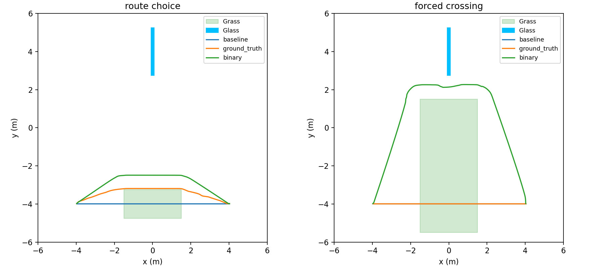

# Graduated-cost scenario design — October 13

The existing 12 m arena supports both experiments with grass-only geometry
variants. Boundary walls, lidar static map, glass, start/goal and all stock
planner/controller settings are unchanged. Grass now costs 40 in the oracle
condition and 254 in the binary ablation. The old grass=0 smoke is historical.

- Route choice: center (0,-4), size 3 x 1.5 m; short clean bypass.
- Forced crossing: center (0,-2), size 3 x 7 m; long clean bypass.

Actual installed NavFn Dijkstra + stock inflation diagnostic:

| Scenario | Condition | Path m | Grass centerline exposure m |
|---|---|---:|---:|
| Route | Stock | 8.000 | 3.000 |
| Route | Graduated | 8.287 | 0 |
| Route | Binary | 8.865 | 0 |
| Forced | Stock | 8.000 | 3.000 |
| Forced | Graduated | 8.000 | 3.000 |
| Forced | Binary | 16.892 | 0 |

[Raw grids, paths and summary](evidence/oct13_design.tar.gz).
This probe uses nominal starts, exact static-map cells and semantic
rectangles, with the installed planner and inflation implementation. It
is not a dynamic costmap/controller trial. All six hypotheses passed;
robot execution and matched-seed robustness remain to be measured.
The diagnostic built after correcting a protected API call; nine Python
regression tests then passed. No navigation runs were used to select geometry.

NavFn uses neutral cost 50 plus 0.8 times the costmap value (confirmed in
the apt-installed Jazzy header). Thus 3 m of cost-40 grass adds approximately
1.92 m of free-space-equivalent path cost. The short bypass is worth taking;
the long bypass is not. This is a declared planner objective, not a claim
that grass has a physically measured damage cost.

Grass exposure is explicitly a centerline metric. Intermediate cost 40 does
not receive the lethal-obstacle inflation margin. A centerline bypass can
therefore leave a wheel or chassis edge over the patch; it is not a claim
of zero footprint overlap. In the first three successful graduated pilot
bypasses, central-band centerline clearance was approximately .065–.147 m,
smaller than the robot's half-width in some segments. Preserve the declared
metric and label this limitation; do not silently pad the grass or alter
costs after observing pilot results.

Run `bash scripts/phase0.sh design` with a fresh diagnostic output directory;
the script refuses to overwrite existing paths. Plot saved results with
`scripts/plot_scenario_design.py`. Launch scenario variants through the
trial runner, which saves and hashes the generated worlds.
