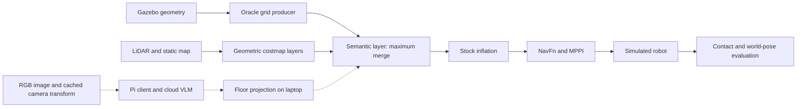

# Methods draft — October 18, 2026

Working manuscript text based on implementation commit `52a33f0`. Campaign
results are pending. This draft distinguishes implemented methods from the
planned cloud extension; external literature and submission formatting remain
to be added.

## Semantic costmap integration

We implement a C++ Nav2 costmap layer independently of the simulation package.
The input is a complete, stamped `nav2_msgs/msg/Costmap` snapshot with its own
frame, resolution, dimensions and planar origin. The layer operates in both
global and local costmaps, after geometric layers and before stock inflation.
For each destination cell center, it transforms the position into the source
grid and samples the corresponding cell. Positive semantic costs replace
unknown destination cells or increase known costs by a maximum merge. Zero
and 255 contribute no semantic penalty and do not clear geometric obstacles
or unknown space. Values 1–252 retain graduated penalties; 253 and 254 retain
Nav2's inscribed and lethal meanings. These values are planning costs, not
calibrated occupancy probabilities or physical risk estimates.

The layer rejects malformed or nonplanar grids, and ignores observations
whose simulated-time age is negative or exceeds five seconds. Cross-frame
lookups use latest-available TF. Source stamps determine observation age,
not exact-time transform matching. Full costmap redraw bounds clear replaced
or expired semantic contributions and support moving local windows. This
simple implementation targets the small benchmark arena; large-map scaling
and hardware safety are not established. Missing or expired input leaves
navigation dependent on the other layers rather than forcing a stop.

## Benchmark and controls

Experiments use ROS 2 Jazzy and Gazebo Harmonic in a 12 m square simulated
arena, with a differential-drive robot, RGB camera and GPU LiDAR. The glass
panel has physical collision geometry and a camera-visible rendering, while
sensor/visual visibility masks suppress its LiDAR returns. Background LiDAR
returns can therefore pass through the panel. Obstacle contact is measured
through Gazebo contact telemetry, rather than inferred from estimated robot
pose. Grass is a visible, physically traversable region.

Three conditions are currently implemented: geometric-only stock Nav2;
binary semantic insertion assigning both glass and grass lethal cost 254;
and graduated insertion assigning glass 254 and grass 40. The latter two
receive identical simulator-derived geometry. These oracle conditions isolate
cost representation from perception error. They do not demonstrate camera
recognition. All use stock NavFn and MPPI parameters except the common
authorized forward/reverse linear speed cap of 0.25 m/s.

The route-choice grass rectangle is centered at (0, -4) m and measures
3 by 1.5 m. The forced-crossing rectangle is centered at (0, -2) m and
measures 3 by 7 m. Grass runs start nominally at (-4, -4) m and target
(4, -4) m; glass runs use the corresponding positions at y=4 m. These
scenarios test whether a moderate cost supports a short clean bypass while
allowing traversal when the clean detour is long. Failure to execute a
planned detour is recorded separately from the planner's route choice.

## Trial protocol and outcomes

Every condition uses real-time factor 0.5, a 1 ms physics step, zero cooldown,
a fresh runner process, a 90 simulated-second navigation timeout and a
45 wall-second startup timeout. Bounded wall watchdogs detect stalled
simulation. Navigation duration is measured in simulated time. Reduced
real-time factor does not preserve controller timing relative to physics;
remaining host-clock uncertainty is an accepted limitation.

The campaign declares 30 attempts in each of three scenarios and four
conditions, including the pending cloud condition: 360 planned attempts.
Seeds 2026101800–2026101829 control matched start perturbations of up to
0.10 m in each planar coordinate and 0.10 rad in yaw. They do not control
AMCL or MPPI internal random streams. Scenario order is fixed and condition
order rotates by seed index. Unavailable conditions remain pending, with
actual execution order retained to expose temporal imbalance. Attempts are
never replaced. The earlier 90-attempt pilot is a separate dataset.

Primary glass outcomes are obstacle contact and Nav2 goal completion without
contact. Passive 20 Hz simulator-pose telemetry measures actual path length,
grass centerline exposure, crossing of the central x band [-1, 1] m and final
physical goal distance. Physical arrival within 0.25 m is reported separately
from Nav2 goal success. Centerline avoidance does not establish avoidance by
the entire swept robot footprint. An incomplete trajectory without a crossing
is not counted as a successful bypass.

Infrastructure failures—including lifecycle startup, missing or rejected
goals, missing required telemetry and stalled simulation—have empty navigation
outcomes. Navigation aborts, timeouts and contacts remain navigation failures.
Usability additionally requires more than one command message and an original
all-command-gap minimum rate of at least 18 Hz. Raw command intervals,
contacts, world and estimated trajectories, resource snapshots, manifests and
launch logs are retained. Unsafe teardown stops the batch.

Analysis will report all attempted outcomes and the preregistered usable
subset with explicit denominators, 95% Wilson rate intervals and matched-seed
comparisons. Exclusion and navigation outcome are separate dimensions:
command gaps may coincide with aborts, so usable-only summaries can conceal
navigation failures. Infrastructure counts remain distinct from navigation
denominators. No campaign outcome is asserted in this draft.

## Planned cloud extension and current evidence boundary

The proposed fourth condition places the cloud API client on a Raspberry
Pi 5 while simulation, geometric projection and costmap publication remain
on the laptop. Deployment is pending. For upright glass with a visible base
on a known planar floor, image-space base endpoints define rays intersected
with the floor; grass uses a ground polygon. The camera transform is cached
at image receipt, with original image time preserved. Invisible, clipped,
near-horizon, stale or excessively uncertain observations are to be rejected
without oracle fallback. This is restricted planar reconstruction, not
general monocular transparent-object depth estimation.

Existing stationary, manually annotated captures validate a limited
calibration case only. They do not establish model accuracy, moving-camera
localization or cloud readiness. Before cloud trials, model/prompt, cadence,
uncertainty thresholds, timeouts and request caps require a dated amendment.
Application acknowledgements and end-to-end latency instrumentation remain
unfinished. Planned latency reporting separates simulated image-to-application
age, laptop monotonic round-trip duration and Pi-local API duration; absolute
timestamps from different machines are not subtracted. Failures, timeouts and
rejections must accompany latency distributions. Local Pi model comparisons
and physical robot validation remain future work.

## System diagram

Solid paths are implemented; dashed paths are planned cloud integration.

Implementation and protocol sources: [layer contract](../../ros2_ws/src/semantic_nav_costmap_layer/README.md),
[preregistration](../experiments/oct13_preregistration.md),
[execution runbook](../experiments/oct18_execution.md), and
[cloud design and calibration limitations](../experiments/cloud_localization_design.md).
