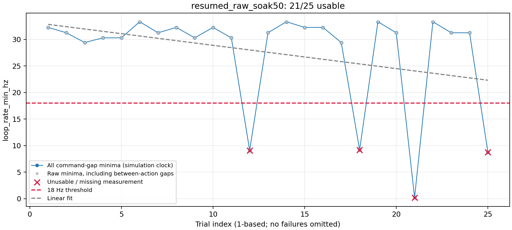
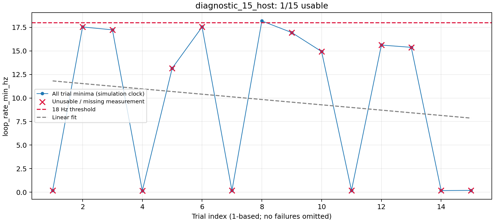
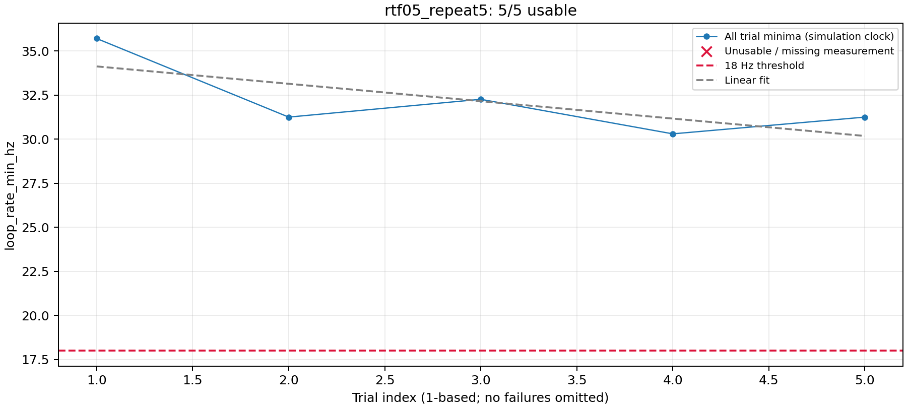

# Phase 0 status — 2026-09-27

**Gate NOT MET. The first 50-trial soak attempt stopped at trial 25.**
RTF 0.5 / zero cooldown / seed 20260927 produced 21 usable attempts out
of 25; trial 25 was an infrastructure failure. No plugin work or data
campaign has started. No further batch was launched after the failure.

## Latest result — partial independent-seed soak

[CSV](evidence/resumed_raw_soak50.csv),
[resources](evidence/resumed_raw_soak50_resources.csv),
[analysis](evidence/resumed_raw_soak50.summary.json),
[manifest](evidence/resumed_raw_soak50_manifest.json),
[all launch logs, intervals, and runtime world](evidence/resumed_raw_soak50_audit.tar.gz).



- 24 navigation successes; 21 usable attempts (84%). Trial numbers below
  are one-based; CSV IDs are zero-based.
- Trials 12, 18, and 21 were excluded at 9.09, 9.17, and 0.20 Hz.
  They reported 1, 1, and 6 recoveries respectively. Their FollowPath-active
  diagnostic minima were 33.33, 32.26, and 32.26 Hz. Trial 21 logged failed
  spin followed by wait. These are retained conservative command-gap
  exclusions, not direct evidence of slow controller computation.
- Trial 25 stopped with `clock_discontinuity`, `host_clock_gap_s=233.457`,
  DDS UDP write failures, and Gazebo/bridge `Network is unreachable` logs.
  `nav2_result` and `success` are empty, `usable=False`, exit status 1.
  The launch log confirms `teardown verified clean`.
- Runner FDs stayed 25, shared memory 335872 bytes / 2 entries. Runner RSS
  rose from 82.100 MB to 83.341 MB (+1.241 MB), with occasional decreases
  and plateaus. This is an upward resource trend worth following, not
  evidence that it caused recovery gaps or the clock/network event.
- Across all attempted minima: slope -0.4384 Hz/trial, 95% CI
  [-0.9590, 0.0821], p=0.0948; first/last-ten means 31.292/24.022 Hz
  (-23.23%). The inspected plot shows intermittent deep gaps, concentrated
  later in the run. A nonsignificant linear fit does not establish no drift.
- Calendar duration was 1542.115 seconds, but the clock discrepancy makes
  throughput unreliable. The analyzer now marks timing invalid and leaves
  wall duration / usable-trials-per-hour empty for clock-failed batches.

The four command clocks stop at realtime 1790569913.138, just before the
first DDS error, and do not bracket the later clock discrepancy. Historical
cause remains unconfirmed. Instrumentation now captures the four clocks at
navigation start, immediately before/at guard detection, navigation result,
and trial/teardown boundaries in `<trial>_clocks.csv`, independently of
command callbacks. This instrumentation was added AFTER the partial soak;
it cannot recover the missing clocks retroactively. Five regression tests
passed in 4.470 s, including a clock jump with no commands and simultaneous
result readiness. Runtime integration of this new event capture remains
untested until the next diagnostic.

Next step: investigate the recurring clock/network event with the new
boundary capture before attempting another comparison or soak. Do not
change the guard, tune Nav2, or relax the gate based on the active metric.
System-level diagnostics or changes outside this project need the user's
permission under the isolation rule. Default RTF remains 1.0; 0.5 is not a
validated experimental protocol. All previous output paths below already
exist and must not be reused.

## Continuation audit — 2026-09-27

The checkout contained later, uncommitted readiness polling, FollowPath
segmentation, and four-clock instrumentation. The user confirmed the host
stayed awake; clock disagreement does not establish sleep or its cause.
See [clock diagnostics](clock_diagnostics.md).

Completed later comparisons were present in `results/phase0`:

| Batch | RTF / cooldown | Usable under original metric | Usable/hour |
|---|---|---|---|
| `bounded_cooldown5.csv` | 1.0 / 10 s | 0/5 | 0 |
| `bounded_rtf05_5.csv` | 0.5 / 0 s | 3/5 | 27.91 |

Neither batch had infrastructure failures. The subsequent
`active_rtf05_5.csv` reported 5/5 using a changed FollowPath-active metric;
its raw minima yield only 3/5. It cannot establish the required gate.
The runner now retains the original all-command-gap metric for gate and
usability decisions (`all_command_gaps_v1`). FollowPath segmentation is
additional diagnostic data only. The analyzer refuses a gate pass for
alternate metrics, retains all attempts, and adds a first/last-ten 10%
practical-drift screen; this is a screening convention, not proof of
stationarity or a replacement for plot review.

Readiness polling is bounded to four requests/second and retries unanswered
requests. No-goal exceptions retain empty navigation fields. Source hashes
now include scenario and launch configuration. Four integration tests passed
in 4.494 s, including conservative recovery-gap handling, no-goal failure
classification, lifecycle readiness, and 30 monitor cleanup cycles (23 FDs
throughout; RSS 78,790,656–78,798,848 bytes).

Fresh [pilot](evidence/resumed_raw_rtf05_5.csv): **5/5 usable and
successful**, 266.223 seconds including launch/teardown, 67.61 usable/hour.
Minima: 31.25, 32.26, 33.33, 34.48, 32.26 Hz. No detected clock discrepancy;
runner FDs 25 throughout; RSS 82,071,552–82,599,936 bytes, ending at
82,448,384. Its manifest records the previous HEAD because the milestone
commit completed after launch; per-file source hashes identify the tested
code. No runtime code was edited during the pilot.

Selected soak candidate: RTF 0.5, zero cooldown, one runner process for all
50 trials, seed 20260927. This is provisional pending the independent soak;
default RTF remains 1.0. If validated, the exact same RTF, cooldown, restart
policy, metric, and timeout must apply across baseline and semantic arms.

```bash
bash scripts/phase0.sh --scenario grass_patch --trials 50 --seed 20260927 \
  --rtf 0.5 --cooldown-sec 0 --out results/phase0/resumed_raw_soak50.csv
python3 scripts/analyze_phase0.py results/phase0/resumed_raw_soak50.csv
```
The older resume commands below are historical; do not overwrite their
now-existing output files.

## Orientation

- Ubuntu 24.04.4 LTS; ROS Jazzy; domain 47, loaded manually through `env.sh`.
- One package (`semantic_nav_sim`); no second package exists to audit.
- Original HEAD: `884fdb9` runner, preceded by `ac8a185` Nav2 and `1de2a36`
  robot/TF/camera. Current deadline supplied by user: October 27, IEEE RA-L.
- Glass has a physical 0.15 x 2.5 x 1.5 m collision box centered at (0,4,0.75).
  Visual flags 2 are excluded by LiDAR mask 1 and included by camera mask 3.
- Stock Nav2 parameters, robot, and world physics step remain unchanged.
- Build before changes: `Summary: 1 package finished [1.72s]`.
  Latest build: `Summary: 1 package finished [1.47s]`.

## Diagnostic evidence

[15-trial CSV](evidence/diagnostic_15_host.csv),
[resource CSV](evidence/diagnostic_15_host_resources.csv),
[analysis](evidence/diagnostic_15_host.summary.json).



This was grass_patch, seed 42, RTF 1.0, zero cooldown. Eight navigation
successes; only 1/15 met the existing minimum-rate criterion. Between
trial 1 and trial 15:

| Measurement | Observation |
|---|---|
| Shared-memory usage | 335872 bytes, constant |
| Shared-memory entries | 2, constant |
| Runner FDs | 32, constant after initial rise from 25 |
| Host process count | 34–37, fluctuating |
| Accessible-process FD total | 233–264, fluctuating |
| Available memory | 15.042–15.081 GB, fluctuating |
| Runner RSS | 81.129 -> 96.547 MB, monotonically increasing |

FD totals exclude inaccessible processes; counts of those processes are
in the CSV. This does not establish host-wide FD absence or prove that
runner RSS caused poor loop rates. No evidence supported DDS segment
removal or daemon cleanup, so neither was applied.

The initial sandbox attempt failed before ROS node creation with
`failed to enumerate interfaces for "udp": -1`. Its CSV is retained in
`results/phase0/diagnostic_15.csv`, but is not an experimental dataset.
The sandbox exposed only two processes. Normal host execution was required.

## Changes and verification

1. CSV resource snapshots at batch start and each completed teardown.
   Cleanup matching is restricted to project working directories, avoiding
   unrelated ROS workspaces with the same binary names.
2. Explicit action-client destruction (not covered by rclpy Node cleanup),
   TF cleanup, node destruction, context shutdown, and garbage collection.
   Cleanup runs even after exceptions and is protected against interruption.
3. Initial pose publication waits for active AMCL and acknowledgment.
   One monotonic readiness deadline checks active bt_navigator, action
   availability, AMCL pose, and TF. No fixed startup delay remains.
4. `goal_sent`, `goal_accepted`, `failure_class`, and `usable` are separate
   fields. No-goal and infrastructure rows have no navigation result.
   Infrastructure failures stop the batch with nonzero exit status.
5. Per-run world copies change only target RTF. Simulation navigation
   deadlines remain equal across RTFs. A wall watchdog and real/monotonic
   clock-discontinuity guard catch host interruptions.
6. Live controller/navigator `use_sim_time` checks, actual RTF, both-clock
   command intervals, and per-run manifests support comparison/audit.

Actual integration test output after these changes:

```text
test_no_goal_timeout_is_not_a_navigation_result ... ok
test_repeated_monitor_cleanup ... ok
test_active_lifecycle_is_required_even_when_action_is_discoverable ... ok
Ran 3 tests in 4.313s
OK
```

The cleanup test creates and destroys 30 real ROS monitors, checks that
weak references are released, and checks FD return. FDs stayed at 23.
The real readiness smoke trial succeeded and returned runner FDs to 25.
Milestones: `38a9521` instrumentation; `915b584` cleanup/readiness.
The user's pre-existing cooldown option is retained and integrated into
comparison metadata; its unverified help-text causal claim was removed.

## RTF pilot and interrupted comparison

[RTF 0.5 pilot CSV](evidence/rtf05_repeat5.csv),
[resources](evidence/rtf05_repeat5_resources.csv),
[analysis](evidence/rtf05_repeat5.summary.json).



Five identical scenario/seed trials at RTF 0.5, no cooldown: **5/5 usable
and successful**, 234.636 seconds including launch/teardown, approximately
76.7 usable trials/hour in this small pilot. Minima were
35.71, 31.25, 32.26, 30.30, 31.25 Hz. Runner FDs stayed at 25; RSS ranged
81.551–81.736 MB, ending slightly below its first-trial value. This removes
the observed monotonic RSS pattern over five full trials, not proof of
unbounded-run stability. A runner-restart workaround is not yet warranted
by these measurements and has not been tested.

At target RTF 0.5, actual RTF was approximately 0.496. Live Nav2 nodes
reported `use_sim_time=true`. Aggregate command rates were about 20.03 Hz
wall-time and 40.33 Hz simulation-time. Thus slower Gazebo does NOT preserve
controller update timing relative to physics; do not claim invariant
trajectories. Any eventual choice must be identical across all conditions.

The RTF 1.0 / 10-second cooldown arm was stopped after one infrastructure
failure: [CSV](evidence/cooldown10_repeat5.csv). `host_clock_gap_s=415.499`;
`nav2_result` and `success` empty; `usable=False`; `error=clock_discontinuity`.
It is not a valid cooldown performance comparison. An earlier interrupted
RTF pilot is retained in `results/phase0/rtf05_5.csv`; discard it for
comparison because it predates the clock-discontinuity guard.

## Measurement limitations

`loop_rate_min_hz` deliberately retains the original reciprocal of the
largest positive simulated-time interval between command callbacks. No
long gaps are filtered out to improve yield. Recovery intervals can therefore
make it pessimistic; it is a command-arrival proxy, not controller compute
duration. Glass navigation failures/recoveries require careful interpretation
in a future data campaign. A usable navigation failure is distinct from
navigation success. Raw wall and simulation intervals are saved for audit.

All validation batches so far use the grass_patch control scenario. The
same runner, RTF, timeout, and cleanup mechanisms serve both scenarios, but
no glass-scenario soak has been established here. Rate improvements in the
pilot are not evidence of semantic navigation performance.

## Resume in order

Keep the host awake and stable. From the project root, rerun the cooldown
arm with fresh output (never overwrite the failed attempts):

```bash
bash scripts/phase0.sh --scenario grass_patch --trials 5 --rtf 1.0 \
  --cooldown-sec 10 --out results/phase0/cooldown10_stable5.csv
python3 scripts/analyze_phase0.py results/phase0/cooldown10_stable5.csv
```

Compare usable trials/hour INCLUDING cooldown against the RTF 0.5 pilot;
repeat the paired pilot if host conditions changed materially. Select a
common RTF/cooldown policy and record it in AGENTS.md. The current defaults
remain RTF 1.0 / zero cooldown; 0.5 is a candidate, not a validated protocol.

If RTF 0.5 / no cooldown wins, run an independent-seed 50-trial soak:

```bash
bash scripts/phase0.sh --scenario grass_patch --trials 50 --seed 20260927 \
  --rtf 0.5 --cooldown-sec 0 --out results/phase0/soak50.csv
python3 scripts/analyze_phase0.py results/phase0/soak50.csv
```

Require at least 48 usable attempts out of 50; inspect every plotted
attempt, the fitted slope, its 95% CI, and resource boundaries. A
nonsignificant slope is not proof of no drift. The analyzer supplies a
screening verdict only; a gate claim requires reviewing the plot and
practical drift magnitude as well. Never omit unsuccessful attempts to
make the plot or yield look better. On any infrastructure failure, resolve
it before starting another batch. Run small fresh-process groups only if
per-process growth persists in the soak. Commit each verified milestone.
